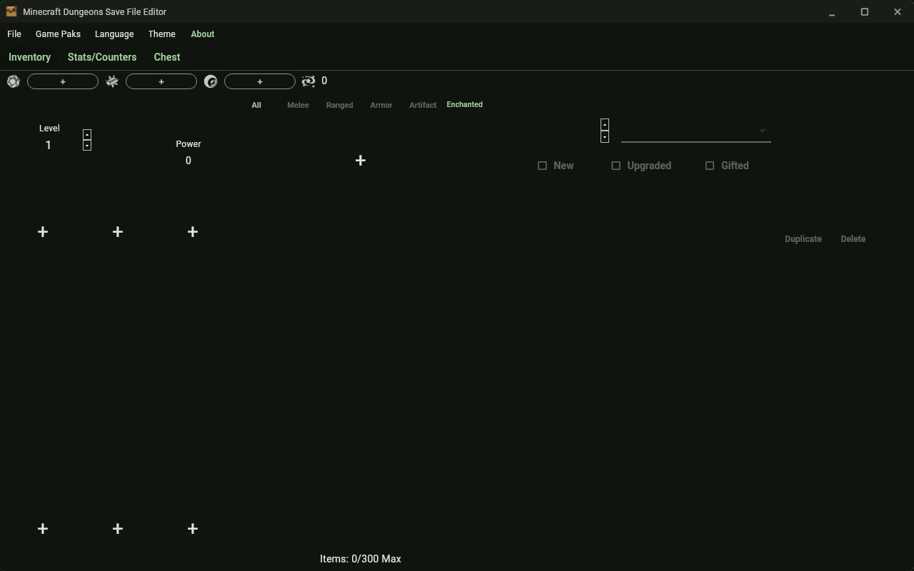
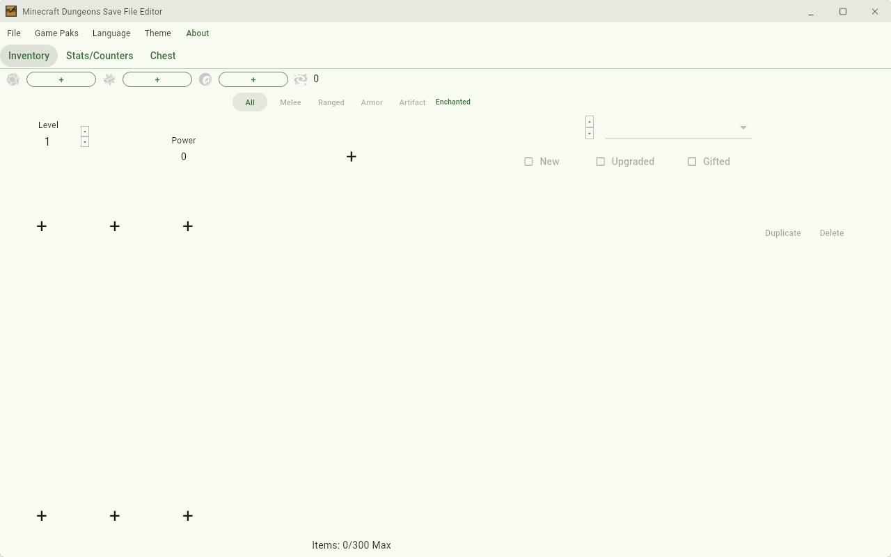
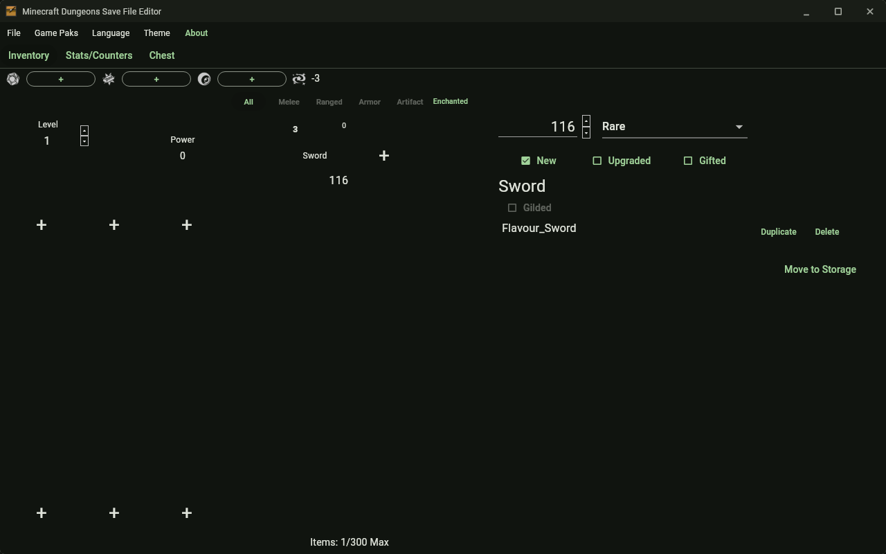

# MCDSE

[](https://gitlab.com/HttpAnimations/mcdse/-/pipelines)
[](https://gitlab.com/HttpAnimations/mcdse/-/releases)
[](https://gitlab.com/HttpAnimations/mcdse/-/blob/master/LICENSE)

**[Download](https://gitlab.com/HttpAnimations/mcdse/-/releases) ·
[Website](https://httpanimations.gitlab.io/mcdse/)**

A desktop port of
[MCDSaveEdit](https://github.com/CutFlame/MCDSaveEdit) — an editor for
*Minecraft Dungeons* character save files.

Runs on **Linux**, **Windows**, and **macOS**.

## Features

- Open encrypted (`.dat`) and decrypted (`.json`) character save files
- Convert between formats automatically on save
- Edit currencies (Emeralds, Gold, Eyes of Ender), unlock the portal
- Edit level, character power, enchantment points
- Inventory + storage chest management: filter, add, duplicate, delete,
  move items between inventory/chest
- Edit gear and hotbar equipment
- Per-item editing: power, rarity, marked-new, upgraded, gifted flags
- Enchantments: tier editing, slot management, gilded (Netherite)
  enchantments, armor properties
- Stats/Counters tab: progress counters and mob kills
- Reads the game's own pak files for item/enchantment images and
  localized names — or runs in a limited mode without them
- Language picker, update checks, drag-and-drop file opening, recent
  files, Ctrl+O/Ctrl+S/Ctrl+Q/Delete shortcuts

## Quick start

```bash
flutter pub get
flutter run -d linux        # or -d windows / -d macos
```

On first launch the app looks for `Dungeons/Content/Paks` in the usual
install locations (Steam, Mojang launcher, Xbox PC) and asks if it can't
find them — you can pick a folder or run with no game content.

Builds:

```bash
flutter build linux      # → build/linux/x64/release/bundle/
flutter build windows
flutter build macos
```

## MCP server (AI agent access)

The project ships an MCP stdio server so an AI agent can read and edit
your save directly. Build the bundle:

```bash
./mcpb/build_mcpb.sh      # → mcdse.mcpb (manifest + compiled server)
```

Install `mcdse.mcpb` in an MCPB-aware client, or point any MCP client at
the compiled binary directly:

```bash
dart build cli -t bin/mcp_server.dart -o build/mcp   # → build/mcp/bundle/bin/mcp_server
```

Tools: `game_catalog` (all item/enchantment/armor-property ids + rules — call first), `detect_save_files`, `open_save`, `save_info`,
`dump_profile_json`, `list_items`, `get_item`, `add_item`,
`update_item`, `duplicate_item`, `move_item`, `remove_item`,
`set_currency`, `set_level`, `set_xp`, `save`. Writes stay in memory
until `save` is called; `.dat` writes encrypted, `.json` decrypted.

The **MCP** menu in the app can also host the same tools in-process:
**MCP → Enable MCP server** starts a Streamable HTTP endpoint at
`http://127.0.0.1:8756/mcp` (persisted, loopback only). Whatever an
agent does through it shows up live in the UI, and files opened in the
UI are mirrored to the agent session. **MCP → Export .mcpb bundle…**
writes an installable bundle to a path you pick.

## Testing

```bash
flutter test            # unit + widget + golden tests
flutter test --update-goldens   # regenerate golden images
flutter analyze         # lint
```

| Dark | Light | Item editor |
|---|---|---|
|  |  |  |

## Not affiliated

This project is not affiliated with Mojang Studios or Microsoft. Image
assets extracted at runtime from game files are Copyright © Mojang.

## License

AGPL-3.0 — see [LICENSE](LICENSE). Original C#/WPF implementation by
Michael Holt (CutFlame), MIT.
